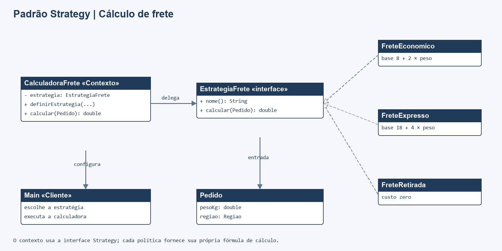

# Padrão Strategy em Java

Aplicação de console que calcula o frete de um pedido usando estratégias intercambiáveis: econômica, expressa ou retirada na loja. A calculadora delega o cálculo à estratégia atual, que pode ser substituída durante a execução.

## Executar

Requer JDK 8 ou superior, sem dependências externas. Na raiz do repositório:

```sh
mkdir out
javac -encoding UTF-8 -d out src/*.java tests/*.java
java -cp out Main
java -cp out StrategyTest
```

Se `out` já existir, pule o `mkdir`. Os testes usam verificações explícitas; qualquer falha lança `AssertionError` e termina com código de erro.

## Participantes

| Papel | Classe/interface |
| --- | --- |
| Contexto | `CalculadoraFrete` |
| Strategy | `EstrategiaFrete` |
| Estratégias concretas | `FreteEconomico`, `FreteExpresso`, `FreteRetirada` |
| Dados usados | `Pedido`, `Regiao` |
| Cliente | `Main` |

Cada política implementa a mesma operação `calcular(Pedido)`. A calculadora usa a estratégia selecionada sem conhecer os detalhes da fórmula de cada opção.

## Diagrama de classes



Fonte editável: [diagrama.mmd](docs/diagrama.mmd).

## Testes

`tests/StrategyTest.java` cobre as três fórmulas, troca de estratégia em tempo de execução, valores de peso diferentes e rejeição de dados nulos ou peso inválido.

As fórmulas são ilustrativas e servem apenas à demonstração do padrão.
